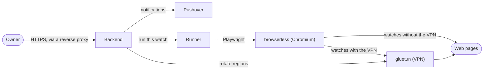

# Lookout

Lookout runs watch scripts against web pages, on demand or on a schedule, keeps the result of every run, and notifies
you when something changes.

A **watch** is something you want checked: a **watch script** that drives a real Chromium through Playwright, plus when
and how to run it. Each **run** ends as a **success**, carrying what the script found on the page, a **known failure**,
a problem the script recognised, such as a page that's blocked from the current VPN region, or a **crash**. Lookout
keeps a screenshot of the page with a run when you ask it to. Runs can go through a VPN that rotates between regions, and
Lookout sends a **notification** (through Pushover, so far) when a run shows a content change, a known-failure streak
reaching its threshold, the start of a crash streak, or a recovery. [`GLOSSARY.md`](GLOSSARY.md) defines each of these.

Lookout is for one person: the **Owner**, who signs in with a username and password set in its settings.

## How it fits together



- **Backend** (`src/Backend`): the ASP.NET Core API and the Angular web UI (`src/frontend`) it serves. It stores
  watches and runs in SQLite, schedules runs, works out each run's events and sends notifications.
- **Runner** (`src/Runner`): runs each watch script with the watch CLI, sandboxed by Node's permission model in a
  locked-down container ([`docs/security.md`](docs/security.md)).
- **browserless**: the Chromium the scripts drive.
- **gluetun**: the VPN, as an HTTP proxy for watches that use it.

## Writing watch scripts

A watch script is a single `.ts` or `.js` file whose default export implements `LookoutWatchScript` from the watch SDK
(`src/watch-sdk`):

```ts
import type { LookoutWatchScript, RunResult } from '@chasepie/lookout-watch-sdk';
import type { Page } from 'playwright';

export default class implements LookoutWatchScript {
  async run(page: Page, signal: AbortSignal): Promise<RunResult> {
    await page.goto('https://shop.example/products/123', { signal });
    const price = await page.locator('.price').innerText({ signal });
    return { success: true, content: price.trim() };
  }
}
```

You upload it when you create or edit a watch. [`examples/`](examples) has a few, and the SDK's
[README](src/watch-sdk/README.md) covers writing them in a project of your own, installing the SDK from GitHub
Packages, and trying them locally with `lookout-watch run`.

## Deploying

CD publishes the Backend's and Runner's images to GHCR: `main` follows the main branch, each `v*` release gets its
version, and `latest` is the highest release. [`deploy/`](deploy) has the Docker Compose file that runs them, and its
[README](deploy/README.md) walks through the settings, the reverse proxy Lookout needs in front of it for HTTPS, and
upgrading.

## Developing

You need the .NET SDK in [`global.json`](global.json), the Node version in [`.nvmrc`](.nvmrc), and Docker.

```sh
npm ci
dotnet run --project src/AppHost
```

The Aspire AppHost starts everything above and opens the Aspire dashboard, with the web UI listed there. It reads these
settings from a `.env` file at the repo root:

| Setting | |
| --- | --- |
| `LOOKOUT_OWNER_USERNAME`, `LOOKOUT_OWNER_PASSWORD` | Required: what you sign in with. The password needs at least 16 characters. |
| `GLUETUN_OPENVPN_USER`, `GLUETUN_OPENVPN_PASSWORD` | Your VPN provider's OpenVPN credentials. gluetun only starts with both. |
| `GLUETUN_VPN_SERVICE_PROVIDER` | gluetun's VPN provider. Default: `private internet access`. |
| `GLUETUN_SERVER_REGIONS` | The VPN regions Lookout may use, comma-separated, as in `DE Berlin,US Texas`. Default: all of them. |
| `TZ` | The time zone of schedules and scripts' dates. Default: `Etc/UTC`. |
| `LOOKOUT_WATCH_SCRIPTS_DIR`, `LOOKOUT_DATABASE_DIR`, `GLUETUN_DATA_DIR` | Where data is kept. Default: a folder for each in `.docker-volumes/`. |

In development, a database with no watches gets one watch for each script in `examples/`.

### Tests and checks

```sh
npm run build -w src/watch-sdk           # the Runner's tests and the TypeScript checks need it built
dotnet test --solution Lookout.slnx      # Backend, Runner and AppHost
npm run test:ci -w src/frontend         # ng test, once
npx playwright install chromium-headless-shell
npm test -w src/watch-sdk
npm run lint && npm run typecheck
dotnet format whitespace Lookout.slnx --verify-no-changes
```

CI (`.github/workflows/ci.yml`) runs all of these on each pull request.

## Documentation

- [`GLOSSARY.md`](GLOSSARY.md): the domain's terms.
- [`docs/security.md`](docs/security.md): signing in, sessions, CSRF protection and how watch scripts are sandboxed.
  Read it before changing anything about them.
- [`docs/adr/`](docs/adr): decisions that would surprise a reader, and why they were made.
- [`deploy/README.md`](deploy/README.md): running Lookout in production.

## License

[MIT](LICENSE)
